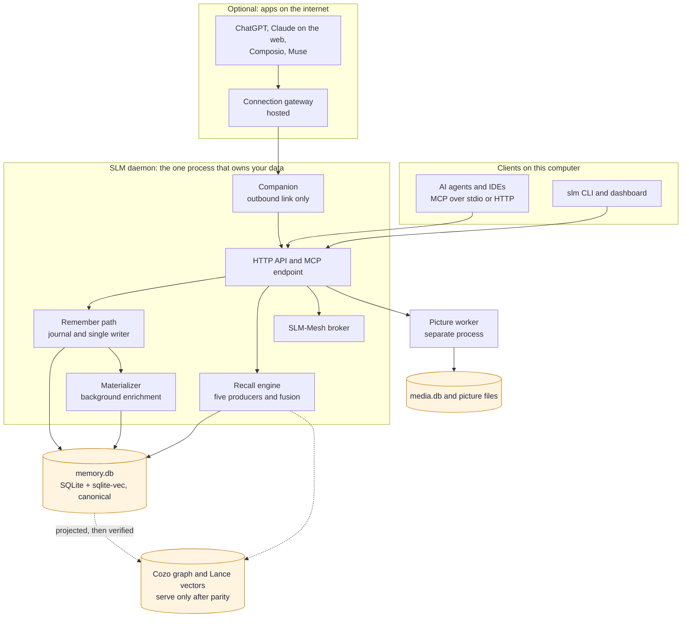

# Architecture

SuperLocalMemory is a governed memory engine that runs on your computer. One background process, the daemon, owns the database and every write to it. Everything else, whether an AI agent, a command line, a dashboard or an app on the internet, talks to that process. This page shows the parts and explains why they are arranged this way. The pages it links to follow each flow end to end.

## The system at a glance

[Download as PNG](images/architecture.png)

Code: `server/unified_daemon.py`, `mcp/` (`_daemon_proxy.py`, `http_transport.py`), `core/remember_runtime.py`, `retrieval/engine.py`, `daemon/materializer.py`, `mesh/broker.py`, `remote_connections/companion.py`, `runtimes/worker_client.py`, `storage/`.

## Why one process owns the data

SQLite allows one writer at a time. Rather than let every tool race for the database, SLM gives the daemon sole ownership. A stdio MCP server started by an IDE does not write on its own; it forwards each call to the daemon. That is why many agents and a dashboard can use one memory at once without corrupting it, and why a write can be journaled, ordered and replayed (see [How Remember Works](How-Remember-Works)). The cost is that the daemon must be running. `slm serve` starts, stops and installs it as a service, and `slm doctor` and `slm restart` handle the cases where it is not.

## Storage: one canonical store, derived projections

The canonical store is `memory.db`, held in SQLite in WAL mode with the sqlite-vec extension for vectors. It holds facts, entities, graph edges, scenes, roles and the evolution log. The agent mesh (peers, messages, shared state, locks) has its own file, `mesh.db`, so mesh traffic never waits on a memory write; mesh activity older than seven days is deleted. The hash-chained audit trail is kept in its own file, `audit_chain.db`, so it survives damage to the main database. Learning signals, answer-check history and saved views are in `learning.db`. Pictures, documents and their vectors are in `media.db` plus a folder of picture files. The data root, `~/.superlocalmemory/` by default, also holds configuration, logs, models and queues, so back up or move the whole folder, never `memory.db` alone.

The optional Scale Engine adds CozoDB for graph queries and LanceDB for approximate vector search. They are derived projections: each is prepared outside the live paths, verified against the canonical store and promoted atomically, and they serve queries only once they match. If anything goes wrong, the daemon falls back to canonical SQLite. Why: a faster index is only acceptable if it can never give a different answer than the database of record.

## What a request goes through

Every write passes the same gates in the same order: identify the caller, check the role on the profile, apply the trust policy, strip secrets, record the request in a journal and commit through the single writer. Enrichment (entity resolution, graph, embeddings) follows in the background so a save returns quickly. A recall runs five producers in parallel, fuses them, drops results with no real evidence, optionally reranks, and finally decides whether any memory supports the question, so that it can answer with results, with the closest labelled memories, or with "That isn't in SuperLocalMemory." The full detail is in [How Remember Works](How-Remember-Works) and [How Recall Works](How-Recall-Works), and the permission logic is in [Security, Company Mode and Teams](Security-Company-Mode-and-Teams).

## Memory boundaries: profiles and scopes

A profile is a workspace. Within a profile a memory is `personal`, `shared` with named profiles or `global`. Reads across profiles are default-deny, so one workspace never sees another's memories unless a policy or an explicit option says so. This is local authorisation and is separate from SLM-Mesh, which coordinates trusted peers. See [Profiles](Profiles).

## Operating modes

| Mode | Language model | Where memory text goes |
|---|---|---|
| A: Local Guardian | None for core memory operations | Stays on this computer with the default local models |
| B: Smart Local | A model on this machine, Ollama by default | Stays on this computer unless the model server is on another host |
| C: Full Power | Your own endpoint or a cloud provider | Configured content is sent to that provider |

Mode A is the default. See [Modes Explained](Modes-Explained) and [Privacy and Data Flow](Privacy-and-Data-Flow) for exactly what can leave in each mode.

## Optional parts

**Pictures and documents** run in a separate worker process so a heavy model never competes with recall; see [Pictures and Documents](Pictures-and-Documents). **SLM-Mesh** lets agents and web apps pass short messages; see [Bots That Talk](Bots-That-Talk). **Web access** lets an AI app on the internet use your memory through an outbound-only link; see [Web Access and Connected Apps](Web-Access-and-Connected-Apps). The local core is complete without any of them.

## Design principles

SLM keeps core memory state in a local data root. Installing it does not add hooks, edit IDE configuration, start a daemon or download a model without your say-so. Retrieval combines several producers and degrades to the indexes that are healthy. Scores are kept apart from confidence: a relevance score ranks results and is never presented as a probability (see [Retrieval Score Contract](Retrieval-Score-Contract)).

## Mathematical foundations

Three layers give the engine its character; the research is in the [paper archive](Research-Foundations).

| Layer | Problem | What it does |
|---|---|---|
| Fisher-Rao similarity | Plain vector similarity ignores how much evidence stands behind a memory | Memories confirmed many times get a tighter confidence region and rank higher |
| Sheaf consistency | Contradictory memories pile up ("we use PostgreSQL", later "we moved to MySQL") | Records a supersedes link from newer to older; the older memory stays. Off by default |
| Langevin lifecycle | Databases grow without limit and old memories dilute results | Moves each memory from active toward archived by access and importance; see [Living Brain](Living-Brain) |

## Where each capability lives

| Capability | Page |
|---|---|
| Governance, trust, retention, GDPR | [Governance](Governance) |
| Living Brain, decay, consolidation | [Living Brain](Living-Brain) |
| Graph, clusters, summaries, entities | [Knowledge Graph and Entities](Knowledge-Graph-and-Entities) |
| Skill evolution | [Skill Evolution](Skill-Evolution) |
| Health and repair | [Health and Repair](Health-and-Repair) |
| Caching and compression | [Optimize](Optimize) |
| Gmail, Calendar and transcripts | [Ingestion Adapters](Ingestion-Adapters) |
| Bounded loops | [Bounded Loops](Bounded-Loops) |
| Every dashboard pane | [Dashboard Tour](Dashboard-Tour) |
