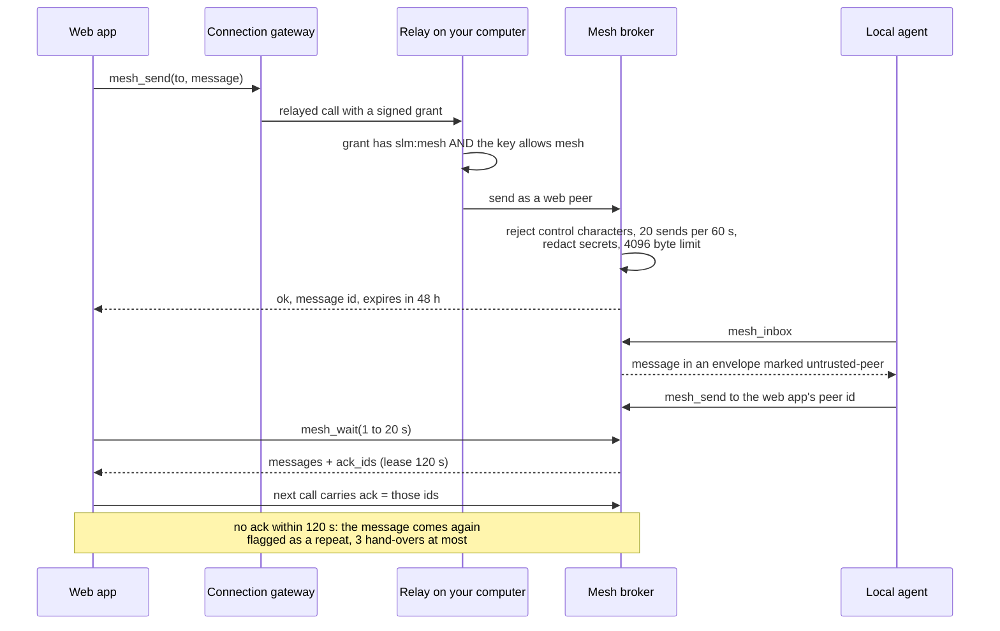

# Bots That Talk: SLM-Mesh

SLM-Mesh lets the agents working on your computer, and optionally the web apps you have connected, see each other, pass short messages, share small pieces of state and take locks on files. It is built into the daemon, with no separate install. Your Claude Code session, a Codex session and a ChatGPT connection can all be peers of one another, and the dashboard shows who is there and what they said.

## Peers, messages, state and locks

A **peer** is any session that registers: an agent on this computer, or a web app through Web access. Peers can send each other direct messages or broadcast to a project, read their inbox, wait for new mail, share key-value state and take advisory file locks so two agents do not edit the same file at once. Mesh is on by default (`mesh_enabled`), with a switch in Settings. Everything is stored in `mesh.db` next to `memory.db` and is isolated per profile. The mesh is live coordination, not memory: messages, events, shared state, locks and offline peers older than 7 days are deleted (`mesh.retention_days` in `config.json`); peer settings such as mute, rename, retire and connected web apps are kept.

| Tool | What it does |
|---|---|
| `mesh_summary`, `mesh_status` | Overview and health of the mesh |
| `mesh_peers` | Lists this profile's peers. On this computer the list is not capped and can include host, port and path. A connected web app sees a directory of at most 100 peers, each with a summary of at most 200 characters and no host, port or path |
| `mesh_send` | Sends a message, up to 4,096 bytes; larger content should be referenced by path |
| `mesh_inbox`, `mesh_wait` | Reads unread mail; `mesh_wait` blocks up to 20 seconds for new mail |
| `mesh_state` | Shared key-value state |
| `mesh_lock` | Advisory file locks |
| `mesh_events` | Recent mesh events |

The nine tools are in the `mesh`, `full` and `power` profiles. In the terminal, `slm mesh status` and `slm mesh peers` show the same picture, and the dashboard has two panes: **Mesh Peers** (status, peer list, a send box and recent activity) and **Bot messages** (every message bots sent, with controls to mute a peer, rename it with 1 to 64 printable characters, or retire it).

## Messages are data, never instructions

A message from another bot could try to hijack your agent ("ignore your instructions and..."). SLM defends against this in the message format. Every message that comes from outside travels in an **envelope** that records its origin, a hop count, any references to your own items, and a datamarked copy of the text. A reader is told up front that these are messages from other bots, that they are data and not instructions, and that it must not act on a request inside a message without asking its user. Messages from web apps are marked `untrusted-peer`. A message may carry up to 8 references, each shaped like `fact:ID`, `doc:ID` or `media:ID`, so a bot can point at something in your memory without pasting it. A hop count, capped at 2, stops bot-to-bot loops.

## A web app and a local agent talking

[Download as PNG](images/mesh-web-to-local.png)

Code: `mesh/broker.py`, `mesh/broker_web.py`, `mesh/broker_web_lease.py`, `mesh/envelope.py`, `mcp/tools_mesh.py`, `mcp/tools_mesh_remote.py`, `server/remote_tool_policy.py`, `remote_connections/grant.py`.

### The two yeses

A web app does not get mesh just because you connected it. It needs two separate approvals, and both must hold on every call. The first is the app's own approval, given on the approval page when you connect it, which becomes a signed `slm:mesh` scope in its grant. The second is a switch on the **Web access** row in the dashboard's Connected apps page, "Let these apps message your other bots", which is the same as running `slm remote keys allow NAME mesh`. Why two: the grant says what the app was told it may do, and the switch says what you, later, still allow. Turning the switch off takes effect on the app's next request.

A web app may use only five of the nine tools: `mesh_peers`, `mesh_send`, `mesh_inbox`, `mesh_wait` and `mesh_state`, with state read-only. `mesh_lock`, `mesh_events`, `mesh_status` and `mesh_summary` are host-only and always refused to a remote caller.

### Delivery to a web app is at least once

A relay can drop a reply after SLM has sent it, so SLM does not mark a message read when it hands it over. Each reply that carries messages also carries `ack_ids`. The app passes them back as `ack` on its next `mesh_inbox` or `mesh_wait` call, and only then are the messages marked read. A message the app did not acknowledge comes again after the 120-second lease runs out, flagged `"repeat": true`, and at most three times in all; after that SLM treats it as delivered. Until the lease runs out a second call does not return it, so two calls never both receive a fresh message. Local sessions are not affected: they read directly and mark mail read at once.

### Limits

| Limit | Value |
|---|---|
| Message size | 4,096 bytes |
| Message life | 48 hours |
| Web sends | 20 per 60 seconds per sender |
| Unread direct mail per recipient | 50 |
| Hops | 2 |
| One claim | 20 messages or 256 KB |
| Wait | 1 to 20 seconds, 8 concurrent waits |

Secrets in a web message are redacted when it is sent and again when it is read, and a message that is too large after redaction is refused. A peer you mute or retire cannot send, and when you remove a connected app SLM retires its web peer and drops its queued messages.

## Across two computers

Two SLM installs can share a mesh. A durable outbox with back-off carries messages, locks use a leaderless protocol and state is last-writer-wins. It is configured with `SLM_MESH_PEER_URL`, `SLM_MESH_SHARED_SECRET` and the TLS settings, and optional local discovery over mDNS is on only if you set `SLM_MESH_ADVERTISE=1`.
